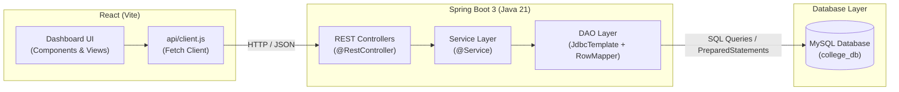

<<<<<<< HEAD
# CollegeManagementSystem


## Getting started

To make it easy for you to get started with GitLab, here's a list of recommended next steps.

Already a pro? Just edit this README.md and make it your own. Want to make it easy? [Use the template at the bottom](#editing-this-readme)!

## Add your files

* [Create](https://docs.gitlab.com/user/project/repository/web_editor/#create-a-file) or [upload](https://docs.gitlab.com/user/project/repository/web_editor/#upload-a-file) files
* [Add files using the command line](https://docs.gitlab.com/topics/git/add_files/#add-files-to-a-git-repository) or push an existing Git repository with the following command:

```
cd existing_repo
git remote add origin https://gitlab.com/shahnawaz-group3/collegemanagementsystem.git
git branch -M main
git push -uf origin main
```

## Integrate with your tools

* [Set up project integrations](https://gitlab.com/shahnawaz-group3/collegemanagementsystem/-/settings/integrations)

## Collaborate with your team

* [Invite team members and collaborators](https://docs.gitlab.com/user/project/members/)
* [Create a new merge request](https://docs.gitlab.com/user/project/merge_requests/creating_merge_requests/)
* [Automatically close issues from merge requests](https://docs.gitlab.com/user/project/issues/managing_issues/#closing-issues-automatically)
* [Enable merge request approvals](https://docs.gitlab.com/user/project/merge_requests/approvals/)
* [Set auto-merge](https://docs.gitlab.com/user/project/merge_requests/auto_merge/)

## Test and Deploy

Use the built-in continuous integration in GitLab.

* [Get started with GitLab CI/CD](https://docs.gitlab.com/ci/quick_start/)
* [Analyze your code for known vulnerabilities with Static Application Security Testing (SAST)](https://docs.gitlab.com/user/application_security/sast/)
* [Deploy to Kubernetes, Amazon EC2, or Amazon ECS using Auto Deploy](https://docs.gitlab.com/topics/autodevops/requirements/)
* [Use pull-based deployments for improved Kubernetes management](https://docs.gitlab.com/user/clusters/agent/)
* [Set up protected environments](https://docs.gitlab.com/ci/environments/protected_environments/)

***

# Editing this README

When you're ready to make this README your own, just edit this file and use the handy template below (or feel free to structure it however you want - this is just a starting point!). Thanks to [makeareadme.com](https://www.makeareadme.com/) for this template.

## Suggestions for a good README

Every project is different, so consider which of these sections apply to yours. The sections used in the template are suggestions for most open source projects. Also keep in mind that while a README can be too long and detailed, too long is better than too short. If you think your README is too long, consider utilizing another form of documentation rather than cutting out information.

## Name
Choose a self-explaining name for your project.

## Description
Let people know what your project can do specifically. Provide context and add a link to any reference visitors might be unfamiliar with. A list of Features or a Background subsection can also be added here. If there are alternatives to your project, this is a good place to list differentiating factors.

## Badges
On some READMEs, you may see small images that convey metadata, such as whether or not all the tests are passing for the project. You can use Shields to add some to your README. Many services also have instructions for adding a badge.

## Visuals
Depending on what you are making, it can be a good idea to include screenshots or even a video (you'll frequently see GIFs rather than actual videos). Tools like ttygif can help, but check out Asciinema for a more sophisticated method.

## Installation
Within a particular ecosystem, there may be a common way of installing things, such as using Yarn, NuGet, or Homebrew. However, consider the possibility that whoever is reading your README is a novice and would like more guidance. Listing specific steps helps remove ambiguity and gets people to using your project as quickly as possible. If it only runs in a specific context like a particular programming language version or operating system or has dependencies that have to be installed manually, also add a Requirements subsection.

## Usage
Use examples liberally, and show the expected output if you can. It's helpful to have inline the smallest example of usage that you can demonstrate, while providing links to more sophisticated examples if they are too long to reasonably include in the README.

## Support
Tell people where they can go to for help. It can be any combination of an issue tracker, a chat room, an email address, etc.

## Roadmap
If you have ideas for releases in the future, it is a good idea to list them in the README.

## Contributing
State if you are open to contributions and what your requirements are for accepting them.

For people who want to make changes to your project, it's helpful to have some documentation on how to get started. Perhaps there is a script that they should run or some environment variables that they need to set. Make these steps explicit. These instructions could also be useful to your future self.

You can also document commands to lint the code or run tests. These steps help to ensure high code quality and reduce the likelihood that the changes inadvertently break something. Having instructions for running tests is especially helpful if it requires external setup, such as starting a Selenium server for testing in a browser.

## Authors and acknowledgment
Show your appreciation to those who have contributed to the project.

## License
For open source projects, say how it is licensed.

## Project status
If you have run out of energy or time for your project, put a note at the top of the README saying that development has slowed down or stopped completely. Someone may choose to fork your project or volunteer to step in as a maintainer or owner, allowing your project to keep going. You can also make an explicit request for maintainers.
=======
# 🎓 College Management System (Full Stack)

A clean, modern, and easy-to-understand full stack **College Management System** built with **React**, **Spring Boot 3**, **Spring JDBC (JdbcTemplate)**, and **MySQL**.

Designed with clarity and simplicity in mind: no overcomplicated ORM boilerplate or complex configs—just straightforward relational data models, explicit SQL queries with `JdbcTemplate`, RESTful APIs, and an intuitive React dashboard.

---

## 🏛️ System Architecture



---

## 📂 Project Structure

```
CollegeManagementSystem/
├── backend/                               # Spring Boot Backend
│   ├── pom.xml                            # Maven dependencies (Web, JDBC, MySQL, H2)
│   ├── mvnw.cmd                           # Maven wrapper script
│   └── src/
│       ├── main/
│       │   ├── java/com/college/cms/
│       │   │   ├── CollegeManagementApplication.java  # Main Application class
│       │   │   ├── config/WebConfig.java             # CORS & API Configuration
│       │   │   ├── model/                            # Data Models (POJOs)
│       │   │   │   ├── Student.java
│       │   │   │   ├── Course.java
│       │   │   │   ├── Department.java
│       │   │   │   ├── Faculty.java
│       │   │   │   ├── Enrollment.java
│       │   │   │   └── DashboardStats.java
│       │   │   ├── dao/                              # Data Access Objects (JdbcTemplate)
│       │   │   │   ├── StudentDao.java
│       │   │   │   ├── CourseDao.java
│       │   │   │   ├── DepartmentDao.java
│       │   │   │   ├── FacultyDao.java
│       │   │   │   └── EnrollmentDao.java
│       │   │   ├── service/                          # Business logic
│       │   │   │   ├── StudentService.java
│       │   │   │   ├── CourseService.java
│       │   │   │   ├── DepartmentService.java
│       │   │   │   ├── FacultyService.java
│       │   │   │   ├── EnrollmentService.java
│       │   │   │   └── DashboardService.java
│       │   │   └── controller/                       # REST Controllers
│       │   │       ├── StudentController.java        # /api/students
│       │   │       ├── CourseController.java         # /api/courses
│       │   │       ├── DepartmentController.java     # /api/departments
│       │   │       ├── FacultyController.java        # /api/faculty
│       │   │       ├── EnrollmentController.java     # /api/enrollments
│       │   │       ├── DashboardController.java      # /api/dashboard
│       │   │       └── GlobalExceptionHandler.java
│       │   └── resources/
│       │       ├── application.properties            # MySQL database configuration
│       │       ├── application-dev.properties        # Out-of-the-box H2 in-memory profile
│       │       ├── schema.sql                        # Table definitions
│       │       └── data.sql                          # Seed data
│       └── test/java/...                             # Integration test suite
│
├── frontend/                              # React Frontend (Vite)
│   ├── package.json
│   ├── vite.config.js
│   ├── index.html
│   └── src/
│       ├── App.jsx                        # Main state and tab navigation
│       ├── main.jsx                       # React DOM entry
│       ├── api/client.js                  # API calls with offline demo fallback
│       ├── styles/app.css                 # Clean modern dashboard styling
│       └── components/
│           ├── Navbar.jsx                 # Header with backend health indicator
│           ├── Sidebar.jsx                # Responsive navigation sidebar
│           ├── DashboardView.jsx          # Metric cards and overview tables
│           ├── StudentsView.jsx           # Student management (CRUD, Search, Filter)
│           ├── CoursesView.jsx            # Course catalog & credit cards
│           ├── FacultyView.jsx            # Professors & HOD directory
│           ├── DepartmentsView.jsx        # Academic departments summary
│           ├── EnrollmentsView.jsx        # Student enrollments & grading
│           └── Modal.jsx                  # Reusable accessible modal dialog
│
├── database/                              # MySQL Scripts
│   ├── schema.sql                         # MySQL database & table creation script
│   └── seed_data.sql                      # Realistic sample data script
│
├── start-backend.bat                      # 1-Click start script for Backend
├── start-frontend.bat                     # 1-Click start script for Frontend
└── README.md                              # Complete documentation
```

---

## 🗄️ Database Design (MySQL)

The relational schema is simple, clean, and normalized:

```
+---------------+        1:N        +-------------+
|  departments  | <---------------- |   faculty   |
+---------------+                   +-------------+
       |                                   |
       | 1:N                               | 1:N
       v                                   v
+---------------+        1:N        +-------------+
|   students    |                   |   courses   |
+---------------+                   +-------------+
       |                                   |
       | 1:N                               | 1:N
       +-------------> +-------------+ <---+
                       | enrollments |
                       +-------------+
```

### Table Definitions

1. **`departments`**: Stores academic divisions (`department_id`, `department_name`, `department_code`, `building`).
2. **`faculty`**: Stores professors and lecturers (`faculty_id`, `first_name`, `last_name`, `email`, `phone`, `designation`, `department_id`).
3. **`students`**: Stores enrolled students (`student_id`, `roll_number`, `first_name`, `last_name`, `email`, `phone`, `department_id`, `semester`, `enrollment_date`, `status`).
4. **`courses`**: Stores subjects and credits (`course_id`, `course_code`, `course_name`, `credits`, `department_id`, `faculty_id`).
5. **`enrollments`**: Connects students with courses with grade tracking (`enrollment_id`, `student_id`, `course_id`, `grade`, `enrollment_date`, `status`).

---

## 🔌 REST API Endpoints

| Method | Endpoint | Description |
|---|---|---|
| `GET` | `/api/dashboard/stats` | Summary counts, recent students & enrollments |
| `GET` | `/api/students` | Get all students (supports `?search=` and `?departmentId=`) |
| `GET` | `/api/students/{id}` | Get student by ID |
| `POST` | `/api/students` | Enroll a new student |
| `PUT` | `/api/students/{id}` | Update student details |
| `DELETE` | `/api/students/{id}` | Remove a student |
| `GET` | `/api/courses` | Get all courses (supports `?departmentId=`) |
| `POST` | `/api/courses` | Create a new course |
| `DELETE` | `/api/courses/{id}` | Remove a course |
| `GET` | `/api/faculty` | Get faculty and professors directory |
| `GET` | `/api/departments` | Get departments with student/course counts |
| `GET` | `/api/enrollments` | Get course enrollments |
| `POST` | `/api/enrollments` | Register student in a course |
| `PUT` | `/api/enrollments/{id}/grade`| Assign or update student grade |

---

## 🚀 How to Run the Application

### 1. Database Setup (MySQL)
Open MySQL Workbench, phpMyAdmin, or your terminal MySQL CLI and run:
```sql
SOURCE c:/CollegeManagementSystem/database/schema.sql;
SOURCE c:/CollegeManagementSystem/database/seed_data.sql;
```
Configure your MySQL credentials in `backend/src/main/resources/application.properties`:
```properties
spring.profiles.active=mysql
spring.datasource.url=jdbc:mysql://localhost:3306/college_db?createDatabaseIfNotExist=true&useSSL=false&allowPublicKeyRetrieval=true&serverTimezone=UTC
spring.datasource.username=root
spring.datasource.password=your_password
```
*(Note: If you want to run without installing MySQL first, `spring.profiles.active=dev` is pre-configured with an in-memory database and seed data so everything works immediately!)*

### 2. Start the Backend (Spring Boot)
Double-click `start-backend.bat` or run:
```powershell
cd backend
.\mvnw.cmd spring-boot:run
```
The REST API will be accessible at: `http://localhost:8080/api/dashboard/stats`

### 3. Start the Frontend (React)
Double-click `start-frontend.bat` or run:
```powershell
cd frontend
npm run dev
```
Open your browser and navigate to: **`http://localhost:5173`**

---

## ✨ Features

- **Dashboard Overview**: Metric cards (Total Students, Faculty, Courses, Departments), recent enrollments, and quick action shortcuts.
- **Student Management**: Full CRUD operations, roll number generation, email and phone management, semester tracking, and live search + department filtering.
- **Course Catalog**: Course cards displaying course codes, credit badges, assigned instructor, and enrollment count.
- **Faculty Directory**: Professor and Head of Department profile cards with contact details.
- **Academic Departments**: Department overview with building location and live counts of students, courses, and professors.
- **Course Enrollments & Grading**: Easy dropdown grade assignment (`A`, `B`, `C`, etc.) and enrollment tracking.
- **Fail-safe Graceful UI**: The React client includes an automatic connection status indicator in the navbar (`Live Spring Boot + MySQL` vs `Demo Mode`), ensuring the UI displays cleanly even before the database server is booted up.
>>>>>>> 5661ed9 (Initial commit)
